<a id="top"></a>

<div align="center">

# ⚡ PokéPulse TCG

### Abre sobres. Arma tu mazo. Gana a los líderes.

Juego de cartas Pokémon *fullstack*: sobres que se abren como los de verdad,<br>
colección propia para cada jugador y combates por turnos resueltos en el servidor.


<br>

**[🚀 Inicio rápido](#inicio)** ·
**[🎴 Colección](#coleccion)** ·
**[📦 Sobres](#sobres)** ·
**[⚔️ Arena](#arena)** ·
**[🏗️ Arquitectura](#arquitectura)** ·
**[📡 API](#api)** ·
**[⚙️ Configuración](#configuracion)** ·
**[🧰 Problemas](#problemas)**

<br>

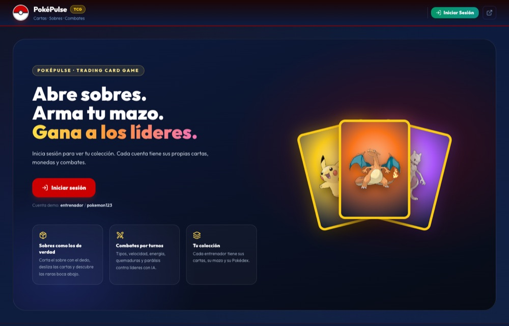

</div>

---

## 📑 Índice

| | Sección | Qué encontrarás |
| :---: | :--- | :--- |
| 🚀 | [**Inicio rápido**](#inicio) | Requisitos, arrancar con un comando, cuentas de prueba |
| 🎮 | [**Cómo funciona**](#como-funciona) | El recorrido de un jugador, de la cuenta al combate |
| 🎴 | [**Colección y mazo**](#coleccion) | Álbum, mazo, subir de nivel, reciclar, Pokédex |
| 📦 | [**Sobres**](#sobres) | Cómo se abren, qué trae cada sobre y probabilidades |
| ⚔️ | [**Arena de combate**](#arena) | Turnos, energía, efectos, tipos y rivales |
| 🛠️ | [**Forja de cartas**](#forja) | Cartas personalizadas y sus reglas |
| 🏗️ | [**Arquitectura**](#arquitectura) | Cómo está montado por dentro |
| 📡 | [**API REST**](#api) | Endpoints y un ejemplo completo con `curl` |
| ⚙️ | [**Configuración**](#configuracion) | Puertos, monedas infinitas y ajustes |
| 🧪 | [**Tests**](#tests) | Qué se prueba y cómo lanzarlo |
| 🧰 | [**Solución de problemas**](#problemas) | Los errores típicos y cómo arreglarlos |
| 🗺️ | [**Próximos pasos**](#roadmap) | Lo que viene |

---

<a id="inicio"></a>

## 🚀 Inicio rápido

### Requisitos

| Herramienta | Versión | Para qué |
| :--- | :--- | :--- |
| 🐳 **Docker Desktop** | cualquiera reciente | Base de datos PostgreSQL |
| ☕ **Java** | 21 o superior | Backend Spring Boot |
| 📦 **Maven** | 3.9+ | Compilar el backend (solo la primera vez) |
| 🟢 **Node.js** | 18+ | Frontend React |

### Arrancar con un comando

> [!IMPORTANT]
> Abre **Docker Desktop** antes de empezar. Sin Docker no hay base de datos.

```bash
cd pokemon/pokemon
./start.sh
```

El script hace todo por ti:

1. 🐳 Levanta **PostgreSQL** en Docker y espera a que esté listo.
2. ☕ Arranca el **backend** (si no existe el `.jar`, lo compila con Maven).
3. ⚛️ Arranca el **frontend** (si falta `node_modules`, ejecuta `npm install`).

Cuando termine, abre **http://localhost:3001** 🎉

Para pararlo todo:

```bash
./stop.sh
```

### Cuentas de prueba

| Usuario | Contraseña | Rol |
| :--- | :--- | :--- |
| `entrenador` | `pokemon123` | 🎒 Entrenador, con la colección principal |
| `admin` | `admin123` | 👑 Administrador, con acceso al panel de usuarios |

<details>
<summary><b>🔧 Arrancar cada parte por separado</b> (útil para desarrollar)</summary>
<br>

```bash
# Terminal 1 · Base de datos
cd pokemon/pokemon
docker compose up

# Terminal 2 · Backend (recarga tus cambios de Java)
cd pokemon/pokemon/backend
mvn spring-boot:run

# Terminal 3 · Frontend (recarga en caliente)
cd pokemon/pokemon/frontend
npm install   # solo la primera vez
npm run dev
```

En **VS Code** también tienes tareas listas en *Terminal → Run Task*: `1. Iniciar PostgreSQL`, `2. Iniciar Backend`, `3. Iniciar Frontend`, `4. Iniciar Todo` y `5. Detener Todo`.

</details>

<p align="right"><a href="#top">⬆ Volver arriba</a></p>

---

<a id="como-funciona"></a>

## 🎮 Cómo funciona

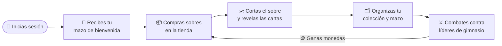

1. **Cada jugador tiene su cuenta.** Al crearla recibes un mazo de bienvenida con 10 cartas. Tus cartas, sobres, monedas y combates son solo tuyos.
2. **Consigues cartas abriendo sobres.** Se compran con PokéMonedas y se abren tocando y deslizando, como un sobre de verdad.
3. **Organizas tu colección.** Eliges qué cartas van al mazo, las subes de nivel o reciclas las repetidas.
4. **Combates por turnos** contra cuatro rivales con IA. Si ganas, cobras monedas y vuelves a por más sobres.

<p align="right"><a href="#top">⬆ Volver arriba</a></p>

---

<a id="coleccion"></a>

## 🎴 Colección y mazo

<div align="center">
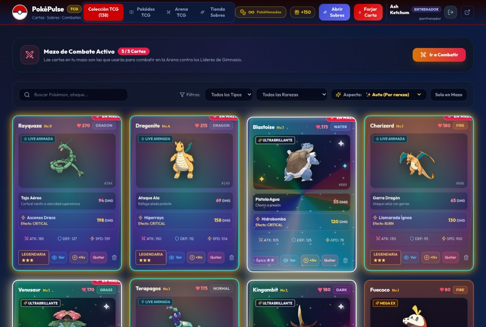
</div>

| Acción | Qué hace |
| :--- | :--- |
| 🔍 **Buscar y filtrar** | Por nombre, ataque, tipo, rareza o solo cartas del mazo |
| ⚔️ **Mazo de combate** | Marca hasta **5 cartas** como tu mazo principal; la Arena las propone primero |
| ⬆️ **Subir de nivel** | Cuesta `nivel × 25` monedas y da **+10 PS, +5 ATK, +4 DEF, +3 VEL** y más daño |
| ♻️ **Reciclar** | Cambia una carta por monedas según su rareza |
| 📖 **Pokédex** | Muestra qué especies tienes y cuáles te faltan |

<details>
<summary><b>♻️ Monedas por reciclar cada rareza</b></summary>
<br>

| Común | Infrecuente | Rara | Épica | Legendaria | Secreta |
| :---: | :---: | :---: | :---: | :---: | :---: |
| 15 | 35 | 75 | 150 | 300 | 1000 |

Las cartas forjadas no dan monedas al reciclarlas ([ver por qué](#forja)).

</details>

<p align="right"><a href="#top">⬆ Volver arriba</a></p>

---

<a id="sobres"></a>

## 📦 Sobres

### Cómo se abre un sobre

<table>
<tr>
<td width="33%" align="center">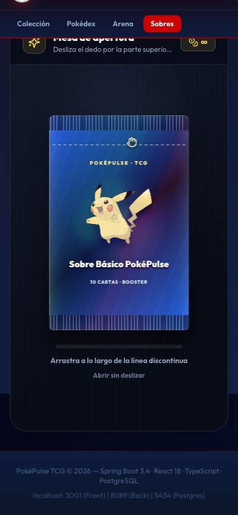</td>
<td width="33%" align="center">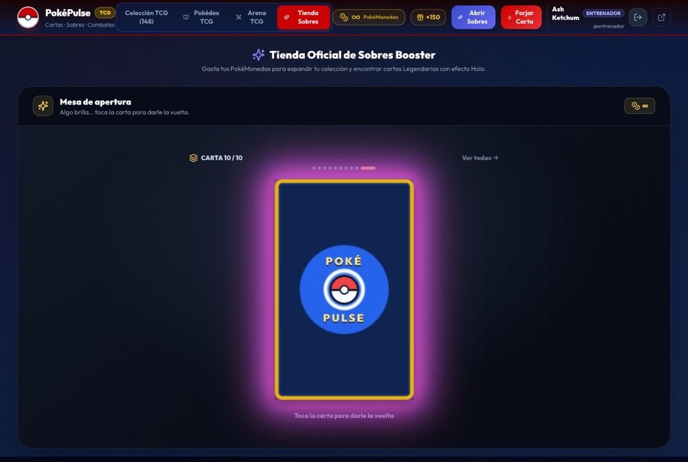</td>
<td width="33%" align="center">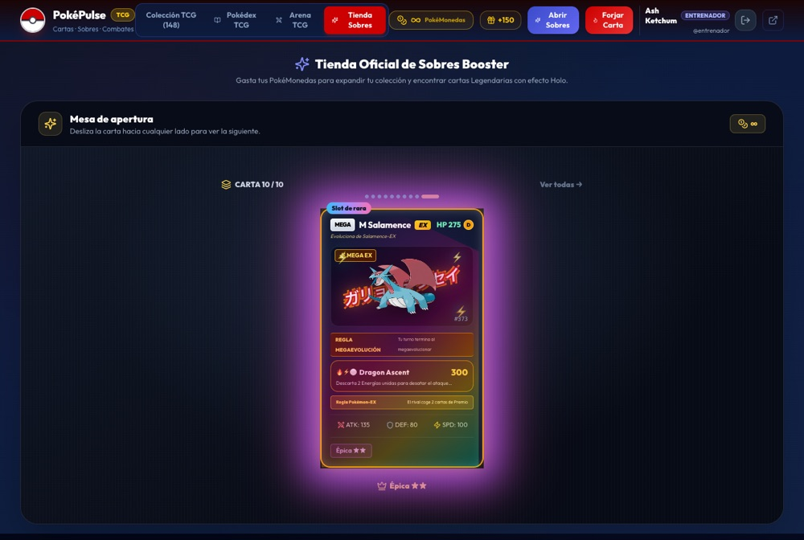</td>
</tr>
<tr>
<td align="center"><b>1 · Corta el sobre</b><br><sub>Desliza el dedo por la línea discontinua de arriba, de lado a lado y sin soltar</sub></td>
<td align="center"><b>2 · Algo brilla…</b><br><sub>Las cartas Épicas o mejores salen boca abajo, con un aura del color de su rareza</sub></td>
<td align="center"><b>3 · Dale la vuelta</b><br><sub>Tócala para descubrirla</sub></td>
</tr>
</table>

- 🃏 Las cartas normales salen boca arriba: **desliza cada una hacia cualquier lado** para ver la siguiente.
- 💜💛🌈 El aura avisa de lo que viene: **morada** para Épica, **dorada** para Legendaria, **arcoíris** para Secreta.
- 🆕 Las especies que no tenías llevan la etiqueta **NUEVA**.
- ⌨️ También funciona con teclado: `Enter` abre el sobre y `→` o `Espacio` pasan las cartas.
- 🛍️ **Comprar y abrir son pasos separados.** Puedes comprar 5 sobres y abrirlos más tarde: quedan guardados como *sobres sellados*.

<div align="center">
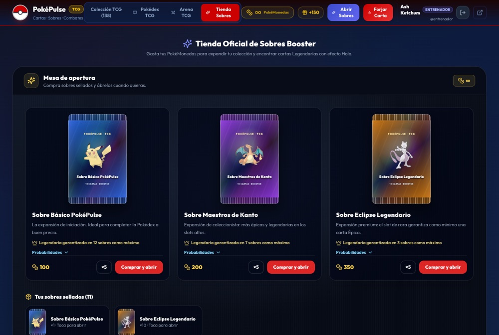
</div>

### Qué trae cada sobre

Todos tienen **10 cartas** colocadas igual que en un booster real: la buena siempre va **al final**.

| Posición | Contenido |
| :---: | :--- |
| 1 – 4 | 🟢 Comunes |
| 5 – 7 | 🔵 Infrecuentes |
| 8 | ✨ Reverse holo (Común, Infrecuente o Rara) |
| 9 | ✨ Reverse holo "alta": puede ser **Épica o mejor** |
| 10 | ⭐ **Rara o superior** |

En un mismo sobre **no se repite ninguna especie**.

### Las tres expansiones

| | 🔵 Básico PokéPulse | 🟣 Maestros de Kanto | 🟡 Eclipse Legendario |
| :--- | :---: | :---: | :---: |
| **Precio** | 100 🪙 | 200 🪙 | 350 🪙 |
| **Carta 10:** Rara | 72 % | 54 % | — |
| **Carta 10:** Épica | 20.5 % | 31 % | **64 %** |
| **Carta 10:** Legendaria | 6.2 % | 12 % | 29 % |
| **Carta 10:** Secreta | 1.3 % | 3 % | 7 % |
| **God Pack** | 0.5 % | 1 % | 2 % |
| **Legendaria garantizada cada** | 15 sobres | 10 sobres | 6 sobres |

> [!TIP]
> **God Pack:** con muy poca probabilidad, las 10 cartas del sobre son Épica o mejor.<br>
> **Garantía (pity):** si llevas muchos sobres seguidos sin Legendaria, el siguiente la trae segura. La tienda te dice cuántos te faltan.

Las probabilidades completas de cada posición se pueden consultar en la propia tienda (*Probabilidades*) y en la API (`GET /api/packs/catalog`).

<div align="center">
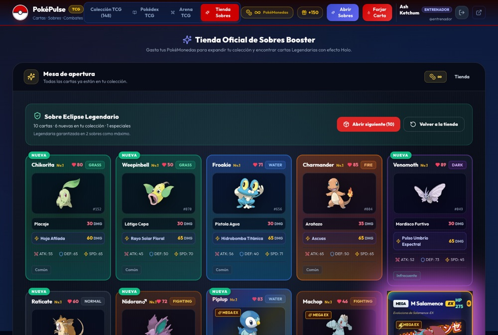
<br><sub>Al terminar ves todas las cartas del sobre, cuántas son nuevas y cuántas especiales.</sub>
</div>

<p align="right"><a href="#top">⬆ Volver arriba</a></p>

---

<a id="arena"></a>

## ⚔️ Arena de combate

<div align="center">
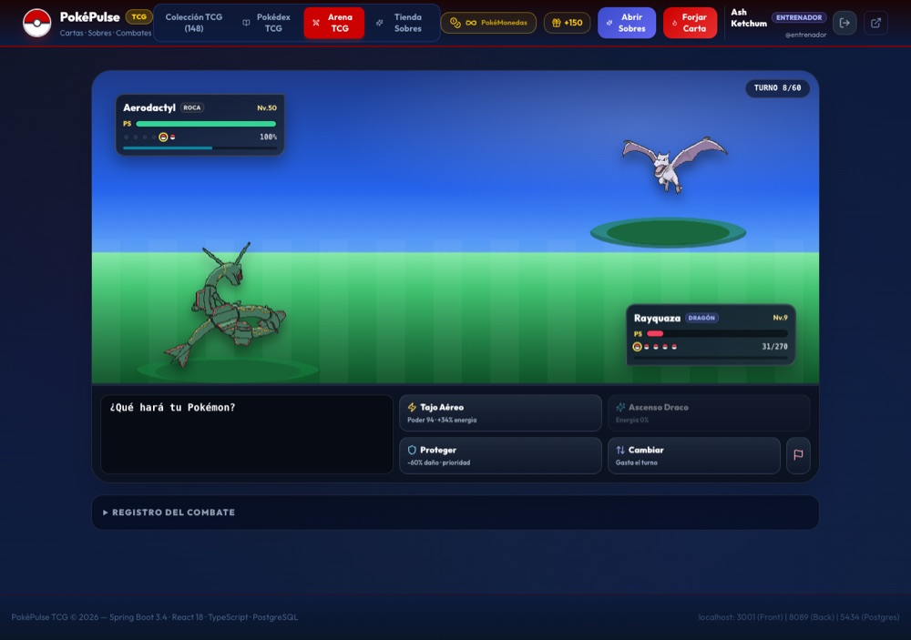
</div>

### Cómo se juega

1. **Elige rival** entre los cuatro disponibles.
2. **Elige tu equipo:** hasta **6 cartas** de tu colección. La primera sale al campo.
3. **Cada turno eliges una acción.** El rival elige la suya y el servidor resuelve las dos.
4. **Gana quien debilita a todo el equipo contrario.** Si llegáis al turno 60, gana quien conserve más PS en total.

<div align="center">
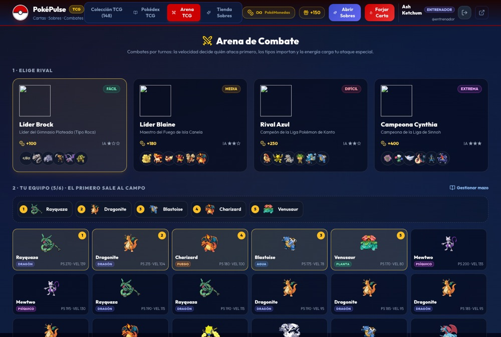
</div>

### Acciones

| Acción | Efecto |
| :--- | :--- |
| ⚡ **Ataque rápido** | Hace daño normal y **carga un 34 % de energía** |
| ✨ **Ataque especial** | Necesita **energía al 100 %**: hace **×1.3 de daño** y activa el efecto de la carta |
| 🛡️ **Proteger** | Recibes **un 60 % menos de daño** este turno y cargas energía. **Falla si lo repites** dos turnos seguidos |
| 🔄 **Cambiar** | Sacas a otro Pokémon de tu equipo (gasta el turno) |
| 🏳️ **Rendirse** | Termina el combate como derrota |

**¿Quién ataca primero?** El Pokémon más **rápido** (VEL). *Proteger* y *Cambiar* van siempre antes que los ataques.

### Efectos especiales de las cartas

| Efecto | Qué hace |
| :--- | :--- |
| 🔥 **Quemadura** | 50 % de probabilidad. El rival pierde 1/12 de sus PS cada turno durante 3 turnos |
| ⚡ **Parálisis** | 40 % de probabilidad. El rival va a la mitad de velocidad y puede perder el turno (35 %) durante 2 turnos |
| 💚 **Curación** | Recuperas el 40 % del daño que has hecho |
| 💥 **Crítico** | El golpe es crítico seguro (×1.5) |

Además, cualquier ataque tiene **1 de cada 16** posibilidades de ser crítico.

### Tipos

Se usa la **tabla de tipos de los juegos** (18 tipos):

| Súper eficaz | Normal | Poco eficaz | "Inmune" |
| :---: | :---: | :---: | :---: |
| **×1.5** | ×1 | ×0.7 | ×0.4 |

> Por ejemplo, Agua contra Fuego hace ×1.5. Las inmunidades se suavizan a ×0.4 para que ninguna carta quede inútil.

<details>
<summary><b>🧮 Fórmula de daño</b></summary>
<br>

```
daño = ((ATK × 0.45 + poder) / (DEF × 0.2 + 10)) × 18
       × tipo × (×1.3 si es especial) × (×1.5 si es crítico)
       × aleatorio entre 0.9 y 1.0
       × (×0.4 si el rival se protege)
```

Mínimo 5 de daño por golpe. Recibir un golpe también te da un 8 % de energía.

</details>

### Rivales

| Rival | Dificultad | IA | Recompensa | Equipo |
| :--- | :---: | :---: | :---: | :--- |
| 🪨 **Líder Brock** | 🟢 Fácil | ★☆☆ | 100 🪙 | Geodude, Onix, Rhyhorn, Kabutops, Aerodactyl, Golem |
| 🔥 **Líder Blaine** | 🟡 Media | ★★☆ | 180 🪙 | Ninetales, Rapidash, Flareon, Magmar, Arcanine, Charizard |
| 🦅 **Rival Azul** | 🔴 Difícil | ★★☆ | 250 🪙 | Pidgeot, Alakazam, Rhydon, Exeggutor, Gyarados, Blastoise |
| 🐉 **Campeona Cynthia** | 🟣 Extrema | ★★★ | 400 🪙 | Spiritomb, Roserade, Togekiss, Milotic, Lucario, Garchomp |

- ★ **Básica:** ataca y usa el especial en cuanto puede.
- ★★ **Media:** a veces se protege cuando tú tienes el especial cargado y saca relevos con **ventaja de tipo**.
- ★★★ **Experta:** como la media, pero se protege mucho más a menudo justo cuando vas a usar el especial.

> [!NOTE]
> **El banquillo del rival está oculto** hasta que cada Pokémon sale al campo. Si recargas la página a mitad de combate, **se retoma donde lo dejaste**. Empezar un combate nuevo con otro a medias cuenta como derrota.

<table>
<tr>
<td width="62%" align="center">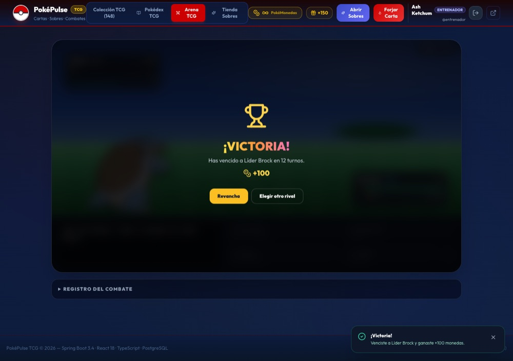</td>
<td width="38%" align="center">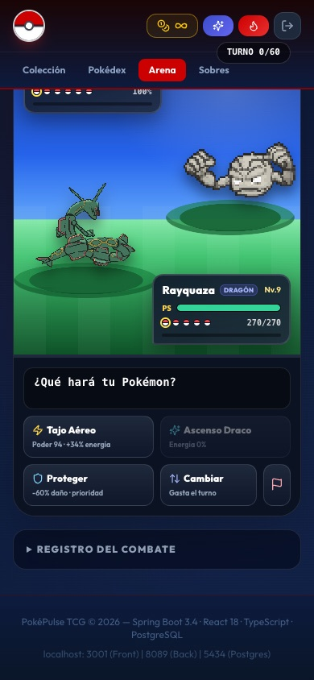</td>
</tr>
<tr>
<td align="center"><sub>Victoria: el servidor te paga la recompensa</sub></td>
<td align="center"><sub>También se juega en el móvil</sub></td>
</tr>
</table>

<p align="right"><a href="#top">⬆ Volver arriba</a></p>

---

<a id="forja"></a>

## 🛠️ Forja de cartas

Con **Forjar Carta** puedes diseñar tus propias cartas: Pokémon, tipo, estadísticas, ataques y efecto.

Igual que en el TCG real, las cartas hechas en casa son ***proxies***:

- 🚫 **No se pueden usar en la Arena.**
- 🪙 **Reciclarlas no da monedas.**
- ✏️ **Son las únicas que se pueden editar.** Las cartas que salen de los sobres no se pueden modificar.

Así no se puede crear gratis una carta invencible ni fabricar monedas.

<p align="right"><a href="#top">⬆ Volver arriba</a></p>

---

<a id="arquitectura"></a>

## 🏗️ Arquitectura

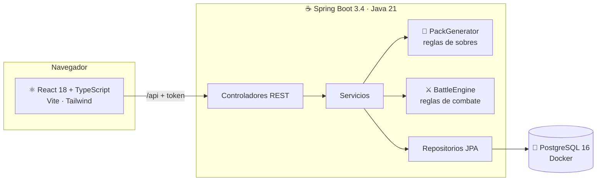

**Ideas clave del diseño:**

- 🔒 **El servidor manda.** El navegador solo dice qué quiere hacer ("abre este sobre", "ataca"); el resultado lo decide el backend. Por eso nadie puede inventarse cartas, victorias ni monedas.
- 👤 **Todo pertenece a un usuario.** Cada carta, sobre y combate tiene dueño. Pedir algo de otro usuario devuelve `404`.
- 🧪 **Las reglas se pueden probar.** `PackGenerator` y `BattleEngine` no tocan la base de datos, así que se prueban con tests rápidos y una semilla fija.
- 🔁 **Migraciones automáticas al arrancar.** Las bases de datos antiguas se actualizan solas (colección por usuario, restricciones de tipos y rarezas).

<details>
<summary><b>📁 Estructura de carpetas</b></summary>
<br>

```
pokemon/pokemon/
├── backend/                     ☕ API Spring Boot
│   └── src/main/java/com/pokepulse/
│       ├── battle/              ⚔️ Motor de combate (reglas, tipos, estado)
│       ├── controller/          🌐 Endpoints REST
│       ├── service/             🧠 Lógica (sobres, cartas, perfiles…)
│       ├── entity/              🗃️ Tablas de la base de datos
│       ├── repository/          🔎 Consultas
│       ├── dto/                 📨 Lo que entra y sale de la API
│       ├── security/            🔐 Usuario de la sesión (@CurrentUser)
│       ├── init/                🌱 Datos iniciales y migraciones
│       └── exception/           ⚠️ Errores con su código HTTP
├── frontend/                    ⚛️ React + Vite
│   └── src/
│       ├── components/          🧩 Arena, mesa de sobres, cartas…
│       ├── services/api.ts      📡 Llamadas al backend
│       └── types/               🏷️ Tipos TypeScript
├── docs/img/                    🖼️ Capturas de este README
├── docker-compose.yml           🐳 PostgreSQL
├── start.sh / stop.sh           ▶️ Arrancar y parar todo
└── .vscode/                     🛠️ Tareas y depuración
```

</details>

<p align="right"><a href="#top">⬆ Volver arriba</a></p>

---

<a id="api"></a>

## 📡 API REST

📖 **Documentación interactiva:** http://localhost:8089/swagger-ui.html

> Para probar endpoints protegidos en Swagger: haz *login* en `/api/auth/login`, copia el `token`, pulsa **Authorize** y pégalo.

Todos los endpoints, salvo los de `/api/auth` y `/api/battle/opponents`, piden la cabecera `Authorization: Bearer <token>`.

<details open>
<summary><b>🔑 Autenticación</b></summary>

| Método | Endpoint | Descripción |
| :--- | :--- | :--- |
| `POST` | `/api/auth/login` | Inicia sesión y devuelve el token |
| `POST` | `/api/auth/register` | Crea una cuenta (con mazo de bienvenida) |
| `GET` | `/api/auth/me` | Datos de la sesión actual |
| `POST` | `/api/auth/logout` | Cierra la sesión |

</details>

<details>
<summary><b>🎴 Cartas y entrenador</b></summary>

| Método | Endpoint | Descripción |
| :--- | :--- | :--- |
| `GET` | `/api/cards` | Tus cartas (filtros: `search`, `type`, `rarity`, `inDeck`) |
| `GET` | `/api/cards/{id}` | Detalle de una carta |
| `POST` | `/api/cards` | Forjar una carta |
| `PUT` | `/api/cards/{id}` | Editar una carta forjada |
| `PATCH` | `/api/cards/{id}/deck` | Meter o sacar del mazo (máx. 5) |
| `POST` | `/api/cards/{id}/level-up` | Subir de nivel |
| `DELETE` | `/api/cards/{id}` | Reciclar por monedas |
| `GET` | `/api/trainer/profile` | Monedas y estadísticas |
| `POST` | `/api/trainer/claim-bonus` | Bono diario de 150 monedas (una vez cada 24 h) |
| `GET` | `/api/pokedex` · `/api/pokedex/stats` | Tu Pokédex |

</details>

<details>
<summary><b>📦 Sobres</b></summary>

| Método | Endpoint | Descripción |
| :--- | :--- | :--- |
| `GET` | `/api/packs/catalog` | Expansiones, precios y probabilidades |
| `POST` | `/api/packs/purchase?type=BASIC&quantity=1` | Comprar sobres sellados (1-10) |
| `GET` | `/api/packs/sealed` | Tus sobres sin abrir |
| `POST` | `/api/packs/sealed/{id}/open` | Abrir un sobre sellado |
| `POST` | `/api/packs/open?type=BASIC` | Comprar y abrir en un paso |

Tipos: `BASIC`, `KANTO_MASTERS`, `LEGENDARY_ECLIPSE`.

</details>

<details>
<summary><b>⚔️ Combates</b></summary>

| Método | Endpoint | Descripción |
| :--- | :--- | :--- |
| `GET` | `/api/battle/opponents` | Rivales con su equipo y recompensa |
| `POST` | `/api/battle/start` | Empezar: `{ "opponentId": "brock", "cardIds": [1, 2, 3] }` |
| `POST` | `/api/battle/{id}/action` | Jugar turno: `{ "action": "ATTACK" }` · `SPECIAL` · `GUARD` · `FORFEIT` · `{ "action": "SWITCH", "switchTo": 2 }` |
| `GET` | `/api/battle/active` | Combate a medias (`204` si no hay) |
| `GET` | `/api/battle/{id}` | Estado de un combate |
| `GET` | `/api/battle/records` | Tus últimos 20 combates |

</details>

<details>
<summary><b>👑 Administración</b> (solo rol ADMIN)</summary>

| Método | Endpoint | Descripción |
| :--- | :--- | :--- |
| `GET` | `/api/admin/users` | Listar usuarios |
| `POST` | `/api/admin/users` | Crear usuario |
| `PUT` | `/api/admin/users/{id}` | Editar usuario (rol, monedas, contraseña…) |
| `DELETE` | `/api/admin/users/{id}` | Borrar usuario y todo lo suyo |

</details>

### Códigos de respuesta

| Código | Significa |
| :---: | :--- |
| `200` / `201` | Todo bien |
| `400` | Petición incorrecta (con un mensaje que explica el motivo) |
| `401` | Falta iniciar sesión o la sesión ha caducado |
| `403` | No tienes permiso (panel de admin) |
| `404` | No existe… o no es tuyo |
| `409` | Choca con el estado actual (sobre ya abierto, bono ya reclamado, combate terminado) |

### Ejemplo completo con `curl`

```bash
API=http://localhost:8089/api

# 1. Iniciar sesión y guardar el token
TOKEN=$(curl -s -X POST $API/auth/login -H 'Content-Type: application/json' \
  -d '{"username":"entrenador","password":"pokemon123"}' | jq -r .token)

# 2. Comprar un sobre y abrirlo
PACK=$(curl -s -X POST "$API/packs/purchase?type=BASIC" \
  -H "Authorization: Bearer $TOKEN" | jq '.purchased[0].id')
curl -s -X POST $API/packs/sealed/$PACK/open -H "Authorization: Bearer $TOKEN" \
  | jq '.cards[] | {slot, rareza: .card.rarity, nombre: .card.name, nueva: .isNew}'

# 3. Empezar un combate contra Brock con tus cartas del mazo
CARTAS=$(curl -s "$API/cards?inDeck=true" -H "Authorization: Bearer $TOKEN" | jq -c '[.[].id]')
BATTLE=$(curl -s -X POST $API/battle/start -H "Authorization: Bearer $TOKEN" \
  -H 'Content-Type: application/json' -d "{\"opponentId\":\"brock\",\"cardIds\":$CARTAS}" | jq .battleId)

# 4. Atacar
curl -s -X POST $API/battle/$BATTLE/action -H "Authorization: Bearer $TOKEN" \
  -H 'Content-Type: application/json' -d '{"action":"ATTACK"}' | jq '.events[].text'
```

<p align="right"><a href="#top">⬆ Volver arriba</a></p>

---

<a id="configuracion"></a>

## ⚙️ Configuración

### Puertos

| Servicio | Dirección |
| :--- | :--- |
| 🌐 Frontend | http://localhost:3001 |
| ⚙️ Backend | http://localhost:8089 |
| 📖 Swagger | http://localhost:8089/swagger-ui.html |
| 🐘 PostgreSQL | `localhost:5434` · BD `pokemon_db` · usuario `pokemon_user` |

### Monedas infinitas (modo pruebas)

En `pokemon/pokemon/backend/src/main/resources/application.yml`:

```yaml
pokepulse:
  dev:
    infinite-coins: true   # ← pon false para jugar con economía real
```

Con `true` las compras no descuentan monedas y la barra superior muestra **∞**. Reinicia el backend después de cambiarlo.

<p align="right"><a href="#top">⬆ Volver arriba</a></p>

---

<a id="tests"></a>

## 🧪 Tests

```bash
cd pokemon/pokemon/backend
mvn test
```

| Test | Qué comprueba |
| :--- | :--- |
| `PackGeneratorTest` | Estructura de 10 cartas, rara al final, sin especies repetidas, garantía de Legendaria, God Packs y que **las probabilidades reales coinciden con las publicadas** (simulando 20 000 sobres) |
| `BattleEngineTest` | Tabla de tipos, orden por velocidad, energía del especial, *Proteger* y su fallo al repetirlo, relevos, fin del combate, curación, quemadura e IA eligiendo relevo con ventaja de tipo |

<p align="right"><a href="#top">⬆ Volver arriba</a></p>

---

<a id="problemas"></a>

## 🧰 Solución de problemas

<details>
<summary><b>❌ "Docker no parece estar en ejecución"</b></summary>
<br>
Abre <b>Docker Desktop</b>, espera a que diga que está en marcha y vuelve a lanzar <code>./start.sh</code>.
</details>

<details>
<summary><b>🔐 Me pide iniciar sesión otra vez después de reiniciar</b></summary>
<br>
Es normal por ahora: las sesiones se guardan en memoria y se pierden al reiniciar el backend. Vuelve a entrar con tu usuario. Se solucionará con JWT (ver <a href="#roadmap">próximos pasos</a>).
</details>

<details>
<summary><b>🔄 He cambiado código del backend y no se nota</b></summary>
<br>
<code>start.sh</code> reutiliza el <code>.jar</code> ya compilado. Bórralo para que lo recompile:

```bash
rm pokemon/pokemon/backend/target/pokepulse-backend-1.0.0.jar
./start.sh
```

O arranca el backend con <code>mvn spring-boot:run</code>, que siempre compila tus cambios.
</details>

<details>
<summary><b>🚪 "Port 8089 / 3001 already in use"</b></summary>
<br>
Ya hay una copia en marcha. Ejecuta <code>./stop.sh</code> y vuelve a arrancar.
</details>

<details>
<summary><b>🪙 No puedo comprar sobres</b></summary>
<br>
Activa las <a href="#configuracion">monedas infinitas</a>, reclama el bono diario (🎁 +150) o gana combates en la Arena.
</details>

<p align="right"><a href="#top">⬆ Volver arriba</a></p>

---

<a id="roadmap"></a>

## 🗺️ Próximos pasos

- [ ] 🔐 Contraseñas con **BCrypt** y sesiones con **JWT** (que no se pierdan al reiniciar)
- [ ] 🗺️ Volver a integrar el **Modo Historia** RPG cuando el juego de cartas esté afianzado
- [x] 📦 Sobres realistas con probabilidades publicadas
- [x] 👤 Colección y monedas por usuario
- [x] ⚔️ Combates por turnos resueltos en el servidor

---

<div align="center">

Hecho con ☕, ⚛️ y mucho ⚡ · Proyecto educativo sin relación con Nintendo, Game Freak ni The Pokémon Company.<br>
Imágenes de Pokémon: [PokeAPI](https://pokeapi.co) · Sprites de entrenadores: [Pokémon Showdown](https://pokemonshowdown.com)

<a href="#top">⬆ Volver arriba</a>

</div>
